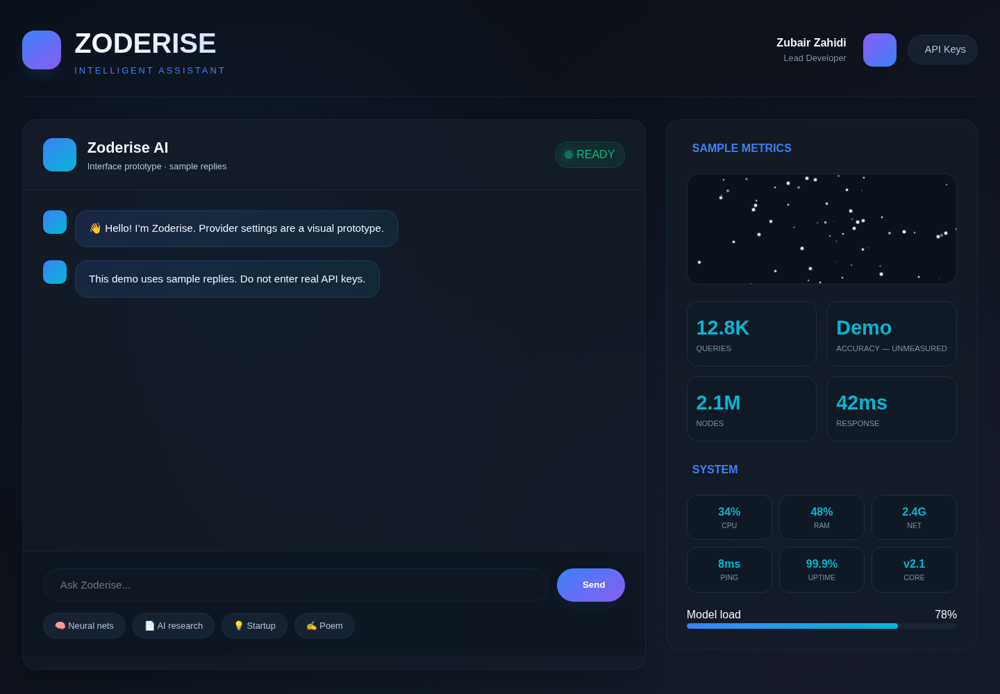

# Chatbot UI — interface prototype

A standalone chatbot interface prototype exploring responsive layout, settings dialogs, and safe text rendering. Built with HTML, CSS, and JavaScript by **Zubair Zahidi**.

## Explore the interface

```sh
python -m http.server 8000 --bind 127.0.0.1
```

Open `chatbot.html` from the local server. The page includes a conversation layout, quick actions, and a provider-settings dialog.

## Current behavior

Replies and dashboard metrics are **simulated UI examples**. No AI provider requests are implemented. The settings dialog is a visual prototype; entered keys are not persisted or used. Do not enter real credentials. Chat text is rendered as text rather than inserted as HTML.

For a working server-side provider integration, see [Crusher](https://github.com/Zubair-zahidi/ai-chatbot-crusher). For a larger local AI application, see [Zoderise Horizon](https://github.com/Zubair-zahidi/zoderise-horizon).

## Development

The interface lives in `chatbot.html`. Serve it locally, check the browser console, and test both narrow and desktop viewports after changes. External fonts and icons may be unavailable on restricted networks. No production API integration or measured model accuracy is claimed.

## Cloud review preview



Captured from the running project on 22 October 2026. Replies and metrics are explicitly simulated UI examples; no AI provider is called.

[Mobile capture](docs/cloud-review/mobile-2026-10-22.png)
