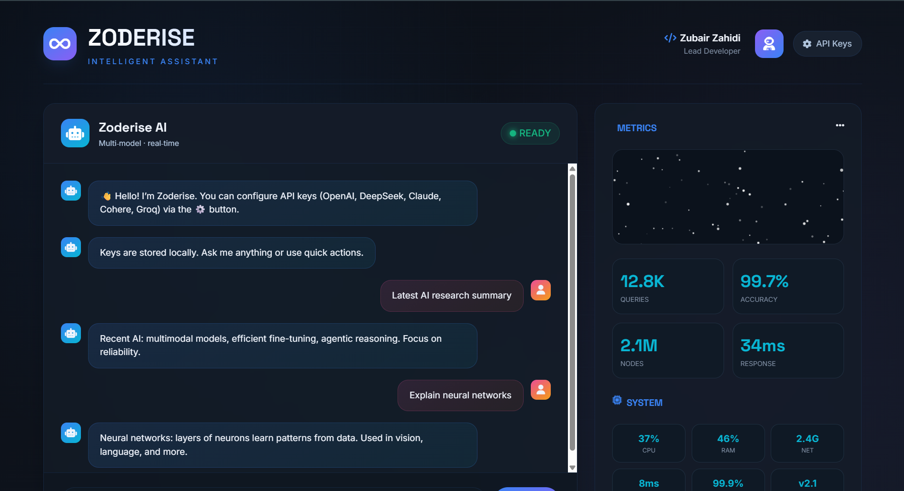
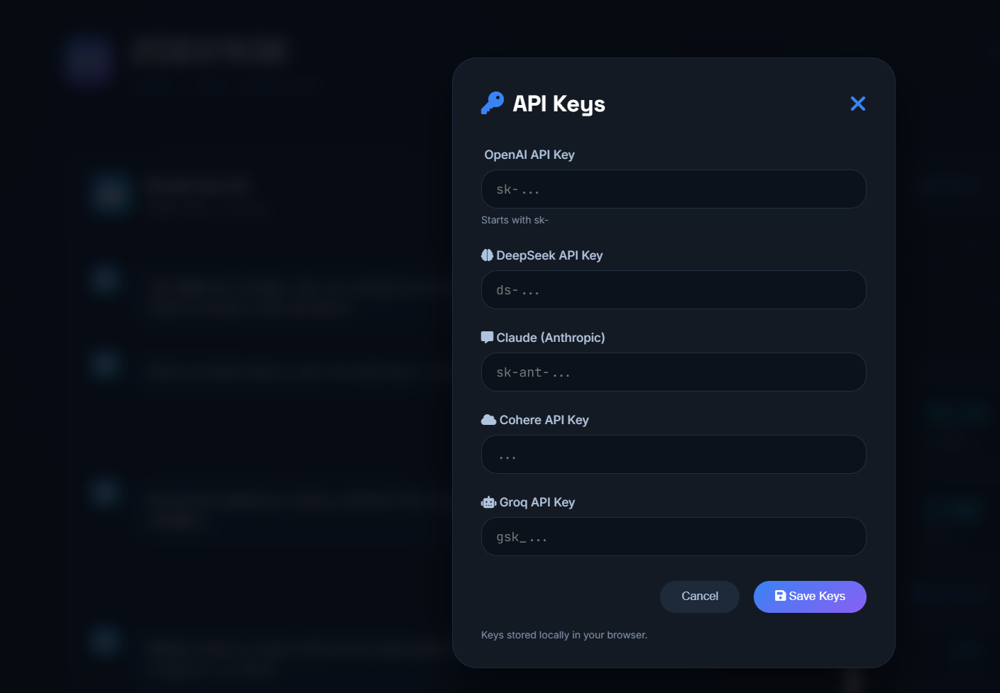

# Chatbot UI — API Prototype

A browser chatbot interface built with HTML, CSS, and JavaScript. It explores a custom chat layout, user-configured API access, and local conversation history.



## Run locally

```bash
git clone https://github.com/Zubair-zahidi/chatbot-ui-api.git
cd chatbot-ui-api
python -m http.server 8000
```

Open `http://localhost:8000/chatbot.html`. Review the JavaScript in `chatbot.html` for the configured provider and request format before supplying credentials. API usage may incur charges from the provider.



## Scope and credentials

This is a browser interface prototype for local experimentation. A password-style input field does not secure an API key against browser scripts or the person using the browser. Use a protected backend for production credential handling, and keep real keys out of source control.

Created by **Zubair Zahidi**.
